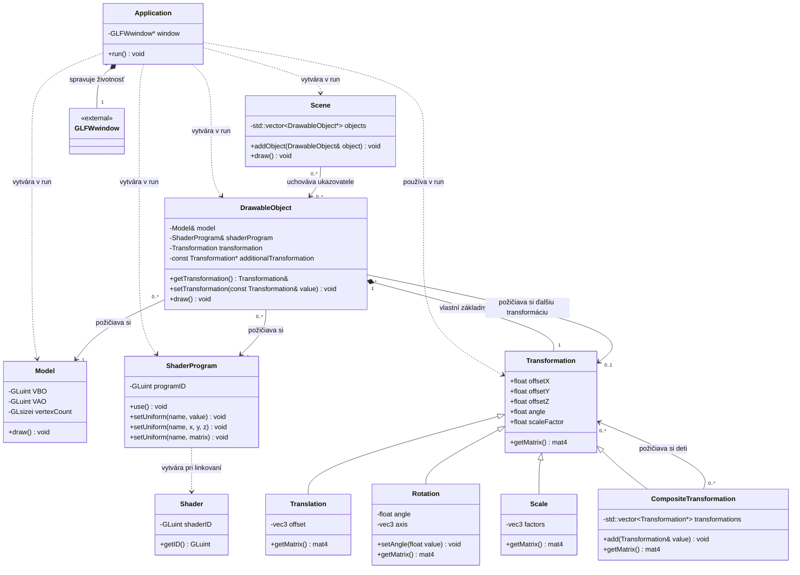

# Triedny diagram - Cvičenie 4

Diagram zachytáva aktuálne triedy, hlavné premenné, vybrané metódy a ich väzby po presune spoločného základu transformácií do triedy `Transformation`.

Pripravené s pomocou ChatGPT podľa zdrojového kódu projektu k 11. 10. 2026.

## Ako čítať diagram

- `+` znamená public a `-` private.
- Prázdny trojuholník `<|--` označuje dedenie; smeruje k rodičovskej triede.
- Plný kosoštvorec `*--` označuje vlastníctvo a je na strane vlastníka.
- Plná šípka `-->` tu označuje uchovávaný ukazovateľ alebo referenciu bez vlastníctva.
- Prerušovaná šípka `..>` označuje používanie triedy, napríklad vytvorenie lokálneho objektu.
- `0..1` znamená nepovinný odkaz a `0..*` ľubovoľný počet.

## Ako diagram zodpovedá kódu

- `Application` vytvára a ruší okno. Scény, objekty, modely, programy a transformácie vytvára ako lokálne premenné v `run()`; nie sú uložené ako členy tejto triedy.
- `Scene` si požičiava objekty. Jeden podpisový objekt môže byť pridaný do viacerých scén.
- `DrawableObject` si požičiava model a shader program. Vlastní základnú `Transformation` ovládanú klávesnicou a môže si požičať ďalšiu transformáciu.
- `Model` spravuje VBO a VAO. Uchováva počet vrcholov, ale neuchováva pôvodné CPU pole vrcholov ako členskú premennú.
- `ShaderProgram` vytvorí dva lokálne objekty `Shader` počas kompilácie a linkovania. Potom spravuje výsledný program; samostatné objekty shaderov nie sú jeho trvalými členmi.
- `Transformation` je konkrétna základná trieda s virtuálnou metódou `getMatrix()` a virtuálnym deštruktorom. Dokáže vytvoriť maticu z posunu, rotácie a mierky.
- `Translation`, `Rotation`, `Scale` a `CompositeTransformation` priamo dedia z `Transformation` a poskytujú vlastnú implementáciu `getMatrix()`.
- `CompositeTransformation` nevlastní svoje deti. Násobí ich matice a jeho dieťaťom môže byť aj ďalší kompozit.
- Vypožičané objekty a transformácie musia existovať počas ich používania. V aktuálnej aplikácii ich životnosť pokrýva celú vykresľovaciu slučku.

## Kompozit v slnečnej sústave

`earthOrbit` spája obežnú rotáciu a posun Zeme od Slnka. Transformácia Zeme k nemu pridáva vlastnú rotáciu a mierku. Transformácia Mesiaca zdieľa `earthOrbit` a pridáva vlastný obeh, posun, rotáciu a mierku; nepreberá vlastnú rotáciu ani mierku Zeme.
