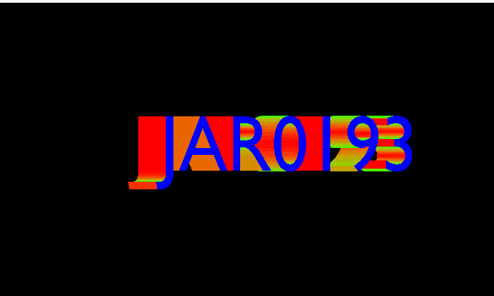
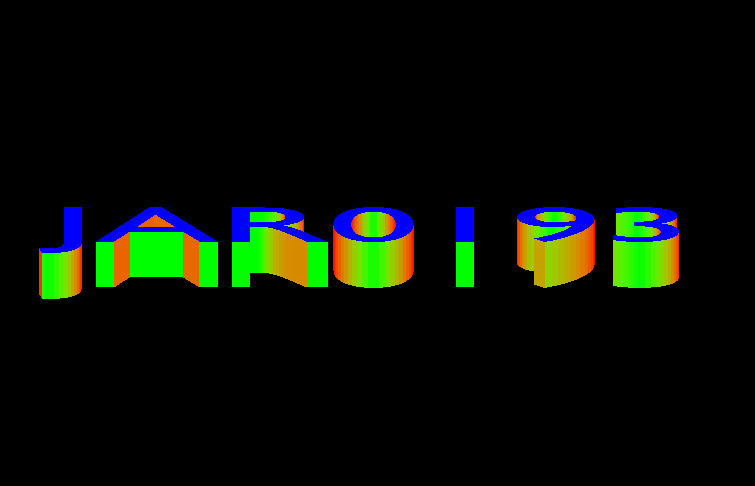
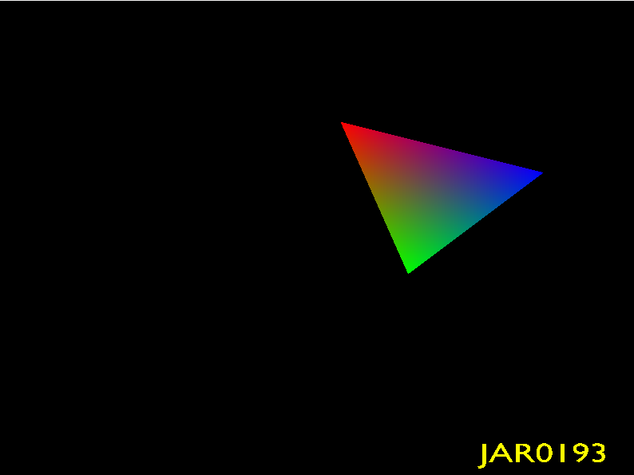
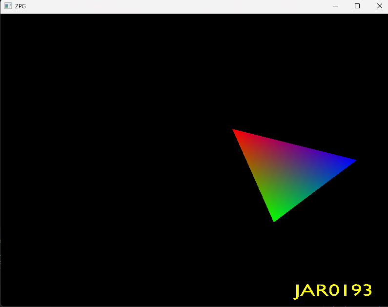
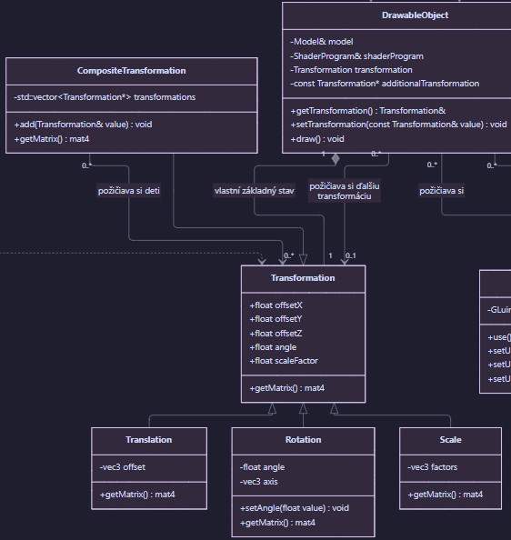
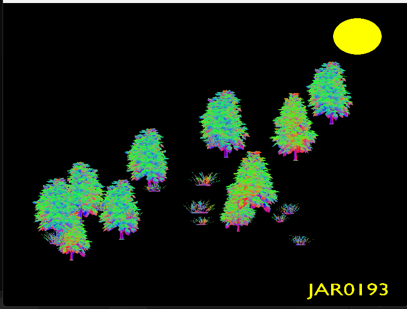
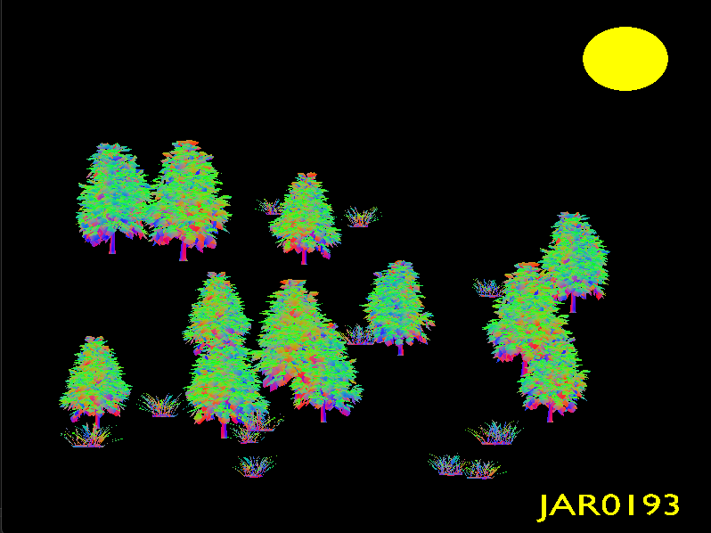

# Cvičenie 4

## 1. Transformácie pomocou modelovej matice

**Splnené** — Posun, rotáciu a zmenu mierky počítam pomocou matíc v GLM. Výslednú maticu posielam do vertex shaderu cez `modelMatrix`, ktorá násobí každý vrchol ako `vec4(position, 1.0)`.

## 2. Transformácie objektov

**Splnené** — Objektu `DrawableObject` môžem cez `setTransformation()` priradiť jednoduchú transformáciu alebo ich kombináciu. Pri vykreslení sa jej matica spojí so základnou transformáciou objektu ovládanou klávesnicou.

## 3. Statické a dynamické transformácie

**Splnené** — Statické transformácie určujú napríklad veľkosť telies a ich vzdialenosti, dynamické menia uhly otáčania podľa uplynutého času. Pohyb slnečnej sústavy je zachytený vo videu pri bode 7.

## 4. Poradie transformácií

**Splnené** — Pri `T * R * S` sa trojuholník najprv zmenší, otočí okolo počiatku modelu a potom posunie; pri `R * T * S` sa otočí aj jeho posunutá poloha okolo počiatku scény. Výsledky sa líšia, pretože násobenie matíc nie je komutatívne.

## 5. Návrhový vzor Kompozit

**Splnené** — Triedy `Translation`, `Rotation`, `Scale` a `CompositeTransformation` dedia z `Transformation`. Kompozit násobí matice svojich detí a môže obsahovať aj ďalší kompozit.

[Celý triedny diagram](CLASS_DIAGRAM.md)

## 6. Náhodne vytvorený les

**Splnené** — Les obsahuje 12 stromov a 12 kríkov s náhodnou polohou, mierkou a rotáciou nastavenou cez triedu `Transformation`. Rozloženie sa vytvára pri spustení aplikácie, preto sa medzi spusteniami líši.

## 7. Slnečná sústava

**Splnené** — Slnko sa otáča, Zem obieha Slnko a Mesiac obieha Zem, pričom sa aj Zem a Mesiac otáčajú okolo vlastných osí. Mesiac zdieľa obežnú transformáciu Zeme, preto ju nasleduje bez preberania jej mierky a vlastnej rotácie.

[Video slnečnej sústavy](<2026-10-11 11-04-49.mp4>)

---
