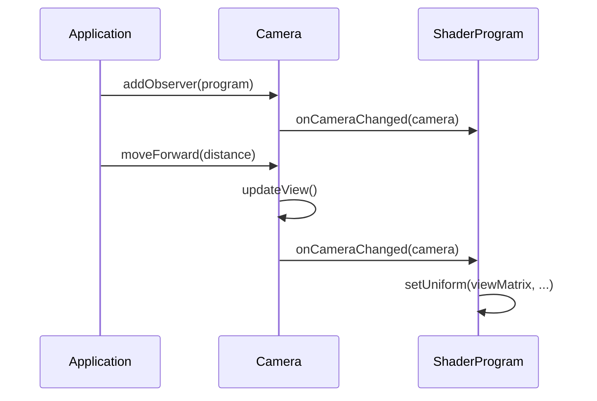

# Úloha 7 - Observer, normálová matica, viditeľnosť a nočný les

Autor projektu: Martin Jarabica, jar0193

Obdobie: 29. október až 1. november 2026. Poznámky vychádzajú zo zadania LMS a Kelvinu, aktuálnych zdrojových súborov a kontrol pri riešení.

Poznámky pripravené s pomocou AI. Ukážky sú vybrané fragmenty projektu; niektoré vynechávajú okolitý kód a nie sú samostatným programom. Formátovanie ukážok môže byť upravené pre čitateľnosť.

Aktívne zdroje sú v `project`. Odovzdávacia kópia je v `Tasks/7.task/project`, stručný súhrn v `Tasks/7.task/jar0193.md`. Toto sú podrobné študijné poznámky k riešeniu.

**Rozdiel medzi aktuálnym nastavením a odovzdávacou verziou:** pri písaní týchto poznámok má aktívny `night.frag` ambient `0.2 * surfaceColor`. Pôvodný nočný obrázok a pripravený ZIP používajú `0.015 * surfaceColor`. Ide o neskoršiu úpravu jasu; balík sme automaticky neprepisovali.

## 1. Týždenný prehľad

Cieľom bolo overiť, že osvetlenie funguje správne aj pri nerovnomernom škálovaní objektu, pri pohľade na odvrátenú stranu a pri zmene veľkosti okna. Vytvorili sme porovnávacie ukážky chybných aj správnych výsledkov, doplnili komunikáciu kamery so shader programami cez Observer a pridali samostatný nočný les s jednou svetluškou.

Nestačilo, aby shader vytvoril pekný odlesk. Poloha fragmentu, normála, poloha svetla aj poloha kamery musia mať správny význam a byť v rovnakom súradnicovom systéme. Preto sa veľká časť cvičenia venovala vysvetleniu chýb a ich príčin.

## 2. Čo sme spravili

- Dokončili sme `CameraObserver` a pripojili kameru ku všetkým používaným shader programom.
- Pridali sme scénu 8 s nerovnomerne škálovanou guľou a tromi režimami transformácie normál.
- Porovnali sme normály bez transformácie, transformáciu modelovou maticou a správnu inverznú transpozíciu.
- V scéne 9 sme demonštrovali nesprávny odlesk na odvrátenej strane pri mocnine 1 a jeho orezanie.
- Overili sme depth test a mazanie hĺbkového bufferu pri každej snímke.
- Zachytili sme chybnú projekciu, chybný viewport a správny resize širokého aj vysokého okna.
- Overili sme maticu z LMS s poslednou hodnotou 5 a opravili svetové súradnice používané pri osvetlení.
- Zachovali sme pôvodný denný les pod klávesom 4 a pridali samostatný nočný les pod klávesom 0.
- Nočný les používa Phongovo osvetlenie, jednu svetlušku, farby povrchov a útlm podľa vzdialenosti.
- Pripravili sme 12 obrázkov, súhrn a odovzdávací ZIP bez knižníc.
- Väčší refactoring, triedy `Light` a `Material` a rozdelenie `Application.cpp` zostali na ďalšiu etapu.

## 3. Ako sme to spravili (Ukážky kódu & Vysvetlenie)

### 3.1 Súradnicové systémy pri osvetlení

| Priestor | Čo v ňom opisujeme |
| --- | --- |
| Lokálny | Vrcholy a normály uložené v modeli |
| Svetový | Umiestnené objekty, svetlo a kamera v spoločnej scéne |
| Pohľadový | Scéna vyjadrená vzhľadom na kameru |
| Orezávací, clip space | Výstup projekcie pred perspektívnym delením |

Modelová matica prevádza vrchol do sveta. Pohľadová matica prevedie svet do súradníc kamery a projekčná matica ho pripraví na zobrazenie:

```glsl
gl_Position = projectionMatrix * viewMatrix
    * modelMatrix * vec4(position, 1.0);
```

Násobenie sa pri stĺpcovom vektore uplatňuje sprava doľava. Najprv sa teda použije modelová transformácia.

V našich osvetľovacích shaderoch počítame svetlo vo **svetovom priestore**. Preto používame svetovú polohu fragmentu, svetovú normálu, `lightPosition` vo svete a `cameraPosition` vo svete. Kombinácia lokálnej normály so svetovou polohou svetla by dávala nesprávny výsledok.

### 3.2 Prečo normálu netransformujeme ako vrchol

Normála opisuje smer kolmý na povrch. Pri transformácii nestačí zachovať jej pôvodný smer alebo ju vynásobiť tou istou maticou ako dotyčnicu povrchu. Musí zostať kolmá na **transformovaný** povrch.

Označme lineárnu časť modelovej transformácie ako `A`, normálu ako `n` a dotyčnicu povrchu ako `t`. Pred transformáciou platí:

```text
nᵀ * t = 0
```

Po transformácii sa dotyčnica zmení na `A*t`. Hľadáme maticu `N` pre normálu tak, aby zostalo:

```text
(N*n)ᵀ * (A*t) = 0
nᵀ * Nᵀ * A * t = 0
```

Štandardnou voľbou je `Nᵀ * A = I`. Odtiaľ dostaneme:

```text
N = transpose(inverse(A))
```

V GLSL:

```glsl
mat3 normalMatrix = transpose(inverse(mat3(modelMatrix)));
vec3 transformedNormal = normalMatrix * normal;
worldNormal = normalize(transformedNormal);
```

Posun objektu nemení smer normály, preto používame lineárnu časť `mat3`. Pri čistej rotácii sa výsledok zhoduje s otočením normály modelovou maticou. Pri rovnomernej mierke môže normalizácia napraviť rozdiel dĺžky; pri nerovnomernej mierke je chybný aj smer.

Jednoduchý príklad bez normalizácie:

```text
n = (1, 1, 0)
t = (1, -1, 0)
A = diag(2, 1, 1)

A*t = (2, -1, 0)
A*n = (2, 1, 0)        -> dot(A*n, A*t) = 3
N*n = (0.5, 1, 0)      -> dot(N*n, A*t) = 0
```

Modelová matica v tomto príklade kolmosť pokazila. Inverzná transpozícia ju zachovala. Inverzia predpokladá nesingulárnu maticu, teda napríklad mierku bez nulovej osi.

### 3.3 Tri režimy normál v scéne 8

V `Application.cpp` vytvárame guľu s nerovnomernou mierkou:

```cpp
Scale normalTestScale(1.5f, 0.5f, 1.0f);

DrawableObject normalTestObject(sphereModel, normalTestProgram);
normalTestObject.getTransformation().scaleFactor = 0.7f;
normalTestObject.setTransformation(normalTestScale);

Scene normalTestScene;
normalTestScene.addObject(normalTestObject);
```

Guľa sa zmení na sploštený elipsoid. Práve nerovnomerná mierka odhalí chybu, ktorá pri čistej rotácii alebo rovnomernej mierke nemusí byť viditeľná.

Vybraný fragment `normal_test.vert`:

```glsl
uniform float normalMode = 2.0;

vec3 transformedNormal;

if (normalMode < 0.5) {
    transformedNormal = normal;
}
else if (normalMode < 1.5) {
    transformedNormal = mat3(modelMatrix) * normal;
}
else {
    mat3 normalMatrix = transpose(inverse(mat3(modelMatrix)));
    transformedNormal = normalMatrix * normal;
}

worldNormal = normalize(transformedNormal);
```

Režim vyberáme pred hlavnou slučkou:

```cpp
normalTestProgram.setUniform("normalMode", 2.0f);
```

| Hodnota | Význam | Obrázok |
| --- | --- | --- |
| 0 | Normála zostane v lokálnom priestore | [Bez transformácie](../../Tasks/7.task/jar0193_1c.png) |
| 1 | Chybné použitie modelovej matice pri nerovnomernej mierke | [Nesprávny prevod](../../Tasks/7.task/jar0193_1a.png) |
| 2 | Správna normálová matica | [Správny prevod](../../Tasks/7.task/jar0193_1b.png) |

Geometria je vo všetkých troch obrázkoch rovnaká. Mení sa normála, a preto aj osvetlenie. Pri vlastnom porovnávaní treba zachovať rovnakú kameru, svetlo a transformáciu objektu.

### 3.4 Prečo normalizujeme normálu aj vo fragment shaderi

Vertex shader odošle normály vrcholov. GPU ich vo vnútri trojuholníka interpoluje a interpolovaný vektor už nemusí mať dĺžku 1.

Vo fragment shaderi preto používame:

```glsl
vec3 normal = normalize(worldNormal);
vec3 lightDirection = normalize(lightPosition - worldPosition.xyz);
vec3 viewDirection = normalize(cameraPosition - worldPosition.xyz);

float diffuseFactor = max(dot(normal, lightDirection), 0.0);
```

Pre jednotkové vektory je skalárny súčin kosínus uhla medzi nimi. Pri smere svetla zhodnom s normálou je hodnota 1, pri kolmom dopade 0 a na odvrátenej strane záporná. `max(..., 0)` zabráni zápornému difúznemu príspevku.

Ak by sme normálu nenormalizovali, výsledok by závisel aj od jej dĺžky a osvetlenie by mohlo byť príliš silné alebo slabé.

### 3.5 Odrazený lúč a Phongov odlesk

`lightDirection` smeruje **z povrchu ku svetlu**. Funkcia `reflect()` však očakáva smer dopadajúceho lúča, preto jej odovzdávame opačný vektor:

```glsl
vec3 reflectionDirection = reflect(-lightDirection, normal);

float specularFactor = pow(
    max(dot(viewDirection, reflectionDirection), 0.0),
    shininess
);
```

Pre jednotkovú normálu používa odraz vzťah `R = I - 2 * dot(N, I) * N`, kde `I` je dopadajúci smer. Pri Phongovom modeli potom porovnávame odrazený smer s pohľadom ku kamere.

Mocnina `shininess` ovplyvňuje šírku odlesku:

- Hodnota 1 vytvorí široký a ľahko pozorovateľný odlesk.
- Vyššie hodnoty, napríklad 32, ho sústredia do užšej oblasti.

Sila odlesku a jeho mocnina sú odlišné veci. Koeficient pred zrkadlovou zložkou upravuje jej intenzitu, mocnina mení priebeh podľa uhla.

### 3.6 Chybný odlesk na odvrátenej strane

Kladný súčin `dot(V, R)` sám nezaručuje, že svetlo na povrch vôbec dopadá. Môže byť kladný aj tam, kde `dot(N, L) <= 0`. Výpočet bez ďalšej podmienky preto vytvorí nesprávny odlesk na tmavej strane.

V `specular_test.frag` máme prepínateľnú ukážku:

```glsl
uniform float shininess = 1.0;
uniform float clipBackfaceSpecular = 1.0;

float specularFactor = 0.0;

if (clipBackfaceSpecular < 0.5 || dotProduct > 0.0) {
    specularFactor = pow(
        max(dot(viewDirection, reflectionDirection), 0.0),
        shininess
    );
}
```

`dotProduct` je v tomto shaderi `max(dot(N, L), 0)`. Podmienka `dotProduct > 0` teda znamená, že fragment je otočený ku svetlu.

Nastavenie v aplikácii:

```cpp
specularTestProgram.setUniform("shininess", 1.0f);
specularTestProgram.setUniform("clipBackfaceSpecular", 1.0f);
```

V scéne 9 je guľa pri počiatku, počiatočná kamera na `(0, 0, 3)` a svetlo na `(0, 0, -3)`:

```cpp
else if (activeScene == &specularTestScene) {
    lightPosition = glm::vec3(0.0f, 0.0f, -3.0f);
}
```

Hodnota `clipBackfaceSpecular = 0` ukazuje [chybný presvit](../../Tasks/7.task/jar0193_2a.png), hodnota 1 [správne orezanie](../../Tasks/7.task/jar0193_2b.png).

Správny výsledok je spredu tmavá guľa s ambientnou zložkou. Svetlo je za ňou, preto predná strana nemá dostať difúzny ani zrkadlový príspevok. Vzhľad tmavého kruhu v tejto konkrétnej ukážke nie je chýbajúce osvetlenie.

### 3.7 Viditeľnosť a z-buffer

Depth test zapíname až po inicializácii OpenGL:

```cpp
glEnable(GL_DEPTH_TEST);
```

Pred každou vykresľovanou snímkou mažeme farebný aj hĺbkový buffer:

```cpp
glClear(GL_COLOR_BUFFER_BIT | GL_DEPTH_BUFFER_BIT);
```

Hĺbkový buffer uchováva hĺbku najbližšieho prijatého fragmentu pre dané miesto obrazu. Pri predvolenej funkcii `GL_LESS` prejde nový fragment, ak je bližší než uložený. Vzdialenejší fragment preto neprepíše bližší objekt len preto, že sa kreslil neskôr.

Samotné `glEnable(GL_DEPTH_TEST)` nestačí, ak by sme medzi snímkami ponechali staré hĺbkové hodnoty. Preto je dôležité aj mazanie `GL_DEPTH_BUFFER_BIT`.

Depth test rieši viditeľnosť z kamery. Automaticky nevytvára tiene vrhané svetlom na iné objekty; tie by vyžadovali ďalší postup, napríklad shadow mapping. Ten v tomto cvičení neimplementujeme.

### 3.8 Viewport a perspektíva pri zmene veľkosti okna

Viewport určuje, do ktorej obdĺžnikovej časti framebufferu sa premietne obraz. Projekcia zase určuje zorné pole a pomer strán. Pri resize musia reagovať obidve časti.

Callback v `Application.cpp`:

```cpp
static void framebuffer_size_callback(
    GLFWwindow* window, int width, int height)
{
    if (updateViewportOnResize) {
        glViewport(0, 0, width, height);
    }
}
```

Používame rozmery **framebufferu**, nie iba logickú veľkosť okna. Tieto rozmery sa môžu líšiť napríklad pri škálovaní displeja.

Relevantná časť `Camera::updateProjection()`:

```cpp
if (width <= 0 || height <= 0) {
    return;
}
if (width == projectionWidth && height == projectionHeight) {
    return;
}

projectionMatrix = glm::perspective(
    glm::radians(90.0f),
    static_cast<float>(width) / static_cast<float>(height),
    0.1f,
    100.0f
);
projectionWidth = width;
projectionHeight = height;
notifyObservers();
```

FOV zostáva 90°. Pri resize meníme pomer strán, nie svojvoľne zorný uhol. Near/far sú 0.1 a 100. Výpočet cez `static_cast<float>` zabraňuje celočíselnému deleniu.

| Viewport / projekcia | Dôsledok | Obrázok |
| --- | --- | --- |
| true / false | Obraz sa natiahne, pretože projekcia má starý pomer strán | [Chybná projekcia](../../Tasks/7.task/jar0193_2c.png) |
| false / true | Používa sa stará oblasť kreslenia a vznikne ďalšie skreslenie | [Chybný viewport](../../Tasks/7.task/jar0193_2c2.png) |
| true / true | Projekcia zodpovedá širokému framebufferu | [Správne široké okno](../../Tasks/7.task/jar0193_2d.png) |
| true / true | Projekcia zodpovedá vysokému framebufferu | [Správne vysoké okno](../../Tasks/7.task/jar0193_2d2.png) |

Finálne nastavenie je:

```cpp
static constexpr bool updateViewportOnResize = true;
static constexpr bool updateProjectionOnResize = true;
```

Gule mimo optickej osi majú malé prirodzené perspektívne skreslenie. Správny resize nepridáva ďalšie natiahnutie jednej osi; neznamená to, že každá projekcia gule musí byť pixelovo dokonalý kruh.

### 3.9 Minimalizované okno a úvodná projekcia

Pri spustení nastavíme viewport aj projekciu bez ohľadu na demonštračné prepínače:

```cpp
glfwGetFramebufferSize(window, &framebufferWidth, &framebufferHeight);
glViewport(0, 0, framebufferWidth, framebufferHeight);
camera.updateProjection(framebufferWidth, framebufferHeight);
```

Prepínače potom ovplyvňujú správanie pri ďalšej zmene veľkosti, takže sa dá ukázať správny počiatočný obraz a následne chybný resize.

V hlavnej slučke:

```cpp
glfwGetFramebufferSize(window, &framebufferWidth, &framebufferHeight);

if (framebufferWidth <= 0 || framebufferHeight <= 0) {
    glfwPollEvents();
    continue;
}

if (updateProjectionOnResize) {
    camera.updateProjection(framebufferWidth, framebufferHeight);
}

glClear(GL_COLOR_BUFFER_BIT | GL_DEPTH_BUFFER_BIT);
```

Pri nulovej veľkosti preskočíme kreslenie, ale spracujeme udalosti okna. Kamera si ponechá poslednú platnú projekciu. Po obnovení okna sa rozmery opäť aktualizujú.

### 3.10 Homogénna matica z LMS a význam hodnoty w

Zadanie žiadalo vyskúšať túto modelovú maticu:

```cpp
glm::mat4 modelMatrix = glm::mat4(
    1.0f, 0.0f, 0.0f, 0.0f,
    0.0f, 1.0f, 0.0f, 0.0f,
    0.0f, 0.0f, 1.0f, 0.0f,
    0.0f, 0.0f, 0.0f, 5.0f
);
```

Nejde o bežnú jednotkovú maticu: posledná hodnota je 5, nie 1. Vrchol `(x, y, z, 1)` sa zmení na `(x, y, z, 5)`. Pri prevode z homogénnych na kartézske súradnice delíme cez `w`, takže dostaneme `(x/5, y/5, z/5)`.

Pre tento test preto očakávame rovnakú geometriu ako pri rovnomernej mierke 0.2. Rovnaké musí byť aj osvetlenie v rovnakých výsledných svetových polohách.

Chyba by vznikla, keby sme pre kreslenie používali správne homogénne súradnice, ale pri osvetlení odčítavali od svetla iba nesprávne `worldPosition.xyz` bez delenia cez `w`. Geometria by už bola zmenšená, no shader by si myslel, že fragmenty ležia inde.

Oprava vo vertex shaderi:

```glsl
vec4 worldHomogeneous = modelMatrix * vec4(position, 1.0);
worldPosition = worldHomogeneous / worldHomogeneous.w;

gl_Position = projectionMatrix * viewMatrix * worldHomogeneous;
```

`worldPosition` je tak vhodná pre výpočet osvetlenia. Pre `gl_Position` zachovávame pôvodný homogénny vektor. Perspektívne delenie výsledného `gl_Position.w`, ktoré vykoná pipeline, nenahrádza tento prevod svetovej polohy pre svetelné výpočty.

Oprava je v `phong.vert`, `normal_test.vert`, `tree.vert` a `bush.vert`. Pri bežných afinných transformáciách s `w = 1` sa výsledok nemení.

Pri kontrole sa matica pripojila ako dodatočná transformácia testovacej gule. Základná mierka 0.7 zostala zachovaná a kamera sa posunula bližšie, aby bola malá guľa čitateľná. Výsledok sa porovnal s dodatočnou mierkou 0.2 pri rovnakej základnej transformácii a kamere:

- [Matica s w = 5](../../Tasks/7.task/jar0193_4a.png).
- [Referenčná mierka 0.2](../../Tasks/7.task/jar0193_4b.png).

Výsledné renderovanie sa pri kontrole zhodovalo bez pixelového rozdielu. Trvalá ďalšia scéna ani testovacia trieda sa do aktívnej aplikácie nepridala.

Na jednoduché ručné zopakovanie možno v `DrawableObject::draw()` dočasne nahradiť vypočítanú `modelMatrix` uvedenou maticou a použiť scénu 8. Pri porovnaní treba rovnako nahradiť aj referenčnú maticu a ponechať rovnakú kameru. Po kontrole sa dočasná úprava odstráni.

### 3.11 Observer medzi kamerou a shader programom

Kamera má oznamovať, že sa zmenila, bez toho, aby poznala konkrétny shader program. Na to slúži Observer:

```cpp
class Camera;

class CameraObserver
{
public:
    virtual ~CameraObserver() = default;
    virtual void onCameraChanged(const Camera& camera) = 0;
};
```

`CameraObserver` je rozhranie. `Camera` drží zoznam pozorovateľov a `ShaderProgram` toto rozhranie implementuje. Dopredná deklarácia `class Camera;` stačí na parameter referencie v hlavičke.

Relevantné časti deklarácií:

```cpp
// Camera owns the list, not the observer objects.
std::vector<CameraObserver*> observers;

// ShaderProgram implements the observer interface.
class ShaderProgram : public CameraObserver
{
public:
    void onCameraChanged(const Camera& camera) override;
    // Other members are omitted here.
};
```

Závislosť je tak oddelená: kamera pracuje s `CameraObserver`, nie s konkrétnou implementáciou `ShaderProgram`. Rovnaké rozhranie by vedel implementovať aj iný objekt, ktorý potrebuje reagovať na kameru.

### 3.12 Prihlásenie, odhlásenie a oznamovanie zmien

Registrácia v `Camera.cpp`:

```cpp
void Camera::addObserver(CameraObserver& observer)
{
    if (std::find(observers.begin(), observers.end(), &observer)
        != observers.end()) {
        return;
    }

    observers.push_back(&observer);
    observer.onCameraChanged(*this);
}
```

Kontrola zabraňuje duplicitnému prihláseniu. Okamžité zavolanie callbacku zabezpečí, že nový shader dostane aktuálny stav hneď a nemusí čakať na prvý pohyb kamery.

Oznamovanie a odhlásenie:

```cpp
void Camera::notifyObservers()
{
    for (CameraObserver* observer : observers) {
        observer->onCameraChanged(*this);
    }
}

void Camera::removeObserver(CameraObserver& observer)
{
    std::erase(observers, &observer);
}
```

`std::erase` používame v projekte s C++20. Pozorovatelia sú požičané ukazovatele, preto musia zostať platní počas používania kamery. Ak by sa pozorovateľ zničil skôr, treba ho včas odhlásiť.

Pri pohybe sa prepočíta pohľad a odošle zmena:

```cpp
void Camera::updateView()
{
    viewMatrix = glm::lookAt(eye, eye + target, up);
    notifyObservers();
}
```

Nulový pohyb a nezmenené rozmery sa ignorujú. Kamera preto nemusí posielať rovnaké matice bez skutočnej zmeny.

### 3.13 Reakcia shader programu na kameru

`ShaderProgram.cpp` načítava aj úplnú definíciu kamery:

```cpp
#include "Camera.h"
```

Samotná dopredná deklarácia stačí pre ukazovateľ alebo referenciu, ale nestačí tam, kde už voláme metódy kamery. To vysvetľuje skoršiu chybu `incomplete type Camera`.

Callback:

```cpp
void ShaderProgram::onCameraChanged(const Camera& camera)
{
    setUniform("viewMatrix", camera.getCamera());
    setUniform("projectionMatrix", camera.getProjectionMatrix());

    if (glGetUniformLocation(programID, "cameraPosition") != -1) {
        const glm::vec3 position = camera.getPosition();
        setUniform("cameraPosition", position.x, position.y, position.z);
    }
}
```

Všetky používané programy potrebujú pohľad a projekciu. Polohu kamery potrebujú najmä modely so zrkadlovou zložkou, preto ju posielame iba vtedy, ak uniform existuje.

Je to dôležité aj preto, že naše `setUniform()` pri chýbajúcom uniforme ukončí aplikáciu. Neposielame teda automaticky každý uniform všetkým shaderom.

Príklad registrácie:

```cpp
Camera camera;
camera.addObserver(phongProgram);
camera.addObserver(normalTestProgram);
camera.addObserver(specularTestProgram);
camera.addObserver(nightTreeProgram);
camera.addObserver(nightBushProgram);
camera.addObserver(nightGroundProgram);
```

Ide o výber z registrácií v aplikácii; celkovo je momentálne pripojených 14 programov. Hlavná slučka už neposiela každej scéne view/projection ručne.



Diagram ukazuje jeden program; kamera oznamuje zmenu všetkým prihláseným pozorovateľom.

### 3.14 Samostatný denný a nočný les

Finálne riešenie má denný les pod klávesom 4 a samostatný nočný les pod klávesom 0. Modely zdieľajú, ale objekty a programy sú samostatné.

```cpp
ShaderProgram treeProgram("tree.vert", "shaders/basic.frag");
ShaderProgram bushProgram("bush.vert", "shaders/basic.frag");

ShaderProgram nightTreeProgram("tree.vert", "night.frag");
ShaderProgram nightBushProgram("bush.vert", "night.frag");
ShaderProgram nightGroundProgram("phong.vert", "night.frag");
```

Nočné programy kombinujú existujúce vertex shadery s novým výpočtom osvetlenia vo fragment shaderi.

`tree.vert` a `bush.vert` teraz okrem farby poskytujú aj svetovú polohu a správne transformovanú normálu:

```glsl
out vec3 vertexColor;
out vec4 worldPosition;
out vec3 worldNormal;
```

Pôvodný farebný fragment shader tieto dodatočné výstupy nepoužíva. Nočný shader z nich vypočíta smer svetla, jeho vzdialenosť a osvetlenie povrchu.

Zem v nočnej scéne:

```cpp
Scene nightForestScene;

DrawableObject nightGroundObject(groundModel, nightGroundProgram);
nightGroundObject.getTransformation() = groundObject.getTransformation();
nightForestScene.addObject(nightGroundObject);
```

Stromy vytvárame ako ďalšie objekty nad tým istým modelom:

```cpp
std::vector<DrawableObject> nightTrees;
nightTrees.reserve(treeCount);

for (int i = 0; i < treeCount; ++i) {
    nightTrees.emplace_back(treeModel, nightTreeProgram);
    DrawableObject& object = nightTrees.back();
    object.getTransformation() = trees[i].getTransformation();
    // The clearing adjustment is omitted in this short example.
    nightForestScene.addObject(object);
}
```

Podobne vytvárame kríky. Nočný les má 74 stromov a 25 kríkov. Časť vegetácie sa v malej oblasti pred počiatočnou kamerou posunie nabok, aby svetlušku hneď nezakrývala.

`reserve()` zabezpečí dostatok miesta pred pridávaním objektov. `Scene` si ukladá ich adresy; presun objektov pri realokácii vektora by tieto ukazovatele zneplatnil. Kopírujeme stav transformácie, nie nový GPU model pre každý strom.

Denný les si zachoval pôvodné slnko, podpis a hodiny. Nočná scéna obsahuje zem, vegetáciu a svetlušku; jasné denné dekorácie do nej nepridávame.

### 3.15 Farby a materiály povrchov

Použitie farieb nastavujeme samostatne pre nočné programy:

```cpp
nightTreeProgram.setUniform("useVertexColor", 1.0f);
nightBushProgram.setUniform("useVertexColor", 1.0f);
nightGroundProgram.setUniform("useVertexColor", 0.0f);
nightGroundProgram.setUniform("materialColor", 0.18f, 0.12f, 0.06f);
```

Fragment shader vyberie farbu:

```glsl
vec3 surfaceColor = materialColor;
if (useVertexColor > 0.5) {
    surfaceColor = vertexColor;
}
```

Strom rozlišuje lístie a drevo podľa poradia vrcholov pripraveného modelu:

```glsl
if (gl_VertexID > 36443) {
    vertexColor = vec3(0.1, 0.6, 0.1);
}
else {
    vertexColor = vec3(0.4, 0.2, 0.05);
}
```

Stromy aj kríky si ponechali jednoduché odtienenie farby podľa lokálnej normály z predchádzajúceho riešenia. Nový fragment shader k tejto základnej farbe pridáva skutočný výpočet bodového osvetlenia.

V tomto stave sú materiálové údaje uniformy a hodnoty shaderov. Samostatná C++ trieda `Material` ešte neexistuje; to je plánovaný refactoring.

### 3.16 Svetluška a poloha jediného bodového svetla

Viditeľná guľka používa jednoduchý žltý shader:

```cpp
DrawableObject fireflyObject(sphereModel, yellowProgram);
Transformation& fireflyTransform = fireflyObject.getTransformation();

fireflyTransform.offsetX = 0.0f;
fireflyTransform.offsetY = -0.3f;
fireflyTransform.offsetZ = 0.0f;
fireflyTransform.scaleFactor = 0.05f;

nightForestScene.addObject(fireflyObject);
```

Výber scény zároveň určuje, čo posúvajú šípky:

```cpp
if (glfwGetKey(window, GLFW_KEY_0) == GLFW_PRESS) {
    activeScene = &nightForestScene;
    activeObject = &fireflyObject;
}
```

Po spracovaní pohybu vyberieme tú istú polohu pre svetlo:

```cpp
else if (activeScene == &nightForestScene) {
    lightPosition = glm::vec3(
        fireflyTransform.offsetX,
        fireflyTransform.offsetY,
        fireflyTransform.offsetZ
    );
}
```

Potom ju odošleme programom používajúcim osvetlenie:

```cpp
for (ShaderProgram* program : lightingPrograms) {
    program->setUniform(
        "lightPosition", lightPosition.x, lightPosition.y, lightPosition.z);
}
```

Viditeľný model svetlušky sám ďalšie svetlo nepridáva. Guľka je značka polohy a nočné shadery pracujú s jedným bodovým svetlom. Preto sa pri posúvaní guľky presúva aj osvetlené okolie.

Pohyb je momentálne ručný cez šípky. Automatickú animáciu svetlušky neuvádzame ako už hotovú vlastnosť.

### 3.17 Útlm svetla podľa vzdialenosti

Najprv zistíme vzdialenosť a až potom vytvoríme jednotkový smer:

```glsl
vec3 toLight = lightPosition - worldPosition.xyz;
float distanceToLight = length(toLight);
vec3 lightDirection = toLight / max(distanceToLight, 0.0001);
```

Keby sme `toLight` najprv normalizovali a až potom merali jeho dĺžku, dostali by sme pri bežnom nenulovom vektore 1 a skutočnú vzdialenosť by sme stratili. Malá dolná hranica v delení bráni deleniu nulou v polohe svetla.

Skrátený zápis funkcie z `night.frag`:

```glsl
uniform vec3 attenuationFactors = vec3(1.0, 0.7, 1.8);

float attenuation(float d)
{
    float denominator = attenuationFactors.x
        + attenuationFactors.y * d
        + attenuationFactors.z * d * d;
    return clamp(1.0 / denominator, 0.0, 1.0);
}
```

Používame vzťah:

```text
att(d) = 1 / (c + l*d + q*d²)
c = 1.0, l = 0.7, q = 1.8
```

| Vzdialenosť d | Približný faktor útlmu |
| --- | --- |
| 0 | 1.000 |
| 1 | 0.286 |
| 2 | 0.104 |
| 3 | 0.052 |
| 5 | 0.020 |

Konštantný člen ovplyvňuje základný menovateľ, lineárny rastie so vzdialenosťou a kvadratický so štvorcom vzdialenosti. Vyšší kvadratický člen spôsobí rýchlejšie slabnutie svetla. Tieto koeficienty nastavujeme podľa mierky a požadovaného vzhľadu scény.

Svetlo nemá ostrú hranicu dosahu. Jeho príspevok plynulo klesá a vo väčšej vzdialenosti sa stane vizuálne zanedbateľným.

### 3.18 Výsledná farba nočného fragmentu

Po výpočte difúzneho faktora a orezaného odlesku skladáme zložky:

```glsl
vec3 ambient = 0.2 * surfaceColor;
vec3 diffuse = diffuseFactor * surfaceColor;
vec3 specular = specularStrength * specularFactor * vec3(1.0);

vec3 directLight = attenuation(distanceToLight)
    * lightColor * (diffuse + specular);

out_Color = vec4(ambient + directLight, 1.0);
```

Toto zodpovedá **aktuálnemu** ambientu 0.2 v pracovnom shadere. V pôvodnej odovzdávacej verzii bol na prvom riadku koeficient 0.015.

Útlm pôsobí na difúznu aj zrkadlovú zložku. Ambient nechávame samostatne ako jednoduchú aproximáciu základného osvetlenia, takže viditeľnosť celého lesa nezávisí iba od vzdialenosti ku svetluške.

Predvolené nočné parametre sú:

```glsl
uniform vec3 lightColor = vec3(2.0, 1.8, 0.8);
uniform float shininess = 16.0;
uniform float specularStrength = 0.15;
```

`lightColor` predstavuje RGB intenzitu svetla, nie farbu povrchu. `surfaceColor` opisuje povrch. Tieto dve zodpovednosti bude neskôr vhodné oddeliť aj triedami `Light` a `Material`.

### 3.19 Ako zmeniť tmu, jas svetlušky a dosah

Ide o tri rôzne nastavenia:

| Čo chceme zmeniť | Kde | Výsledok |
| --- | --- | --- |
| Základnú tmu celého lesa | Násobok `surfaceColor` v `ambient` | Mení aj oblasti ďaleko od svetlušky |
| Intenzitu priameho svetla | `lightColor` | Zosilní alebo zoslabí osvetlené okolie |
| Rýchlosť slabnutia s vzdialenosťou | `attenuationFactors` | Mení priebeh dosahu svetla |

Príklady ambientného koeficientu:

- `0.005`: veľmi tmavý les.
- `0.015`: pôvodné nočné nastavenie použité v odovzdávacom obrázku.
- `0.05`: svetlejšie pozadie.
- `0.1`: výraznejší základný jas.
- `0.2`: aktuálne svetlejšie nastavenie aktívneho shaderu.

Silnejšie priame svetlo s približne rovnakým farebným pomerom možno nastaviť takto:

```glsl
uniform vec3 lightColor = vec3(3.0, 2.7, 1.2);
```

Zvýšenie ambientu zároveň zmenší vizuálny rozdiel medzi osvetleným a vzdialeným lesom. Pri odovzdávacej ukážke má byť dobre čitateľné, že príspevok svetlušky so vzdialenosťou slabne.

Shadery sa načítajú a skompilujú pri vytváraní programov. Po úprave súboru preto aplikáciu znovu spustíme; automatický hot reload nemáme.

### 3.20 Prehľad aktuálneho ovládania

| Kláves | Scéna |
| --- | --- |
| 1 | Login |
| 2 | Jedna guľa a podpis |
| 3 | Transformácie trojuholníka |
| 4 | Pôvodný denný les so slnkom a hodinami |
| 5 | Planéty a lode |
| 6 | Hodiny |
| 7 | Štyri gule s rovnakým osvetľovacím programom, aktuálne Lambert |
| 8 | Test transformácie normál |
| 9 | Test odlesku na odvrátenej strane |
| 0 | Nočný les so svetluškou |

WASD pohybuje kamerou a pravé tlačidlo myši otáča pohľad. Šípky posúvajú vybraný objekt, Q/E ho otáča a Z/X mení jeho mierku. V nočnej scéne šípky ovládajú svetlušku. Kamera je spoločná pre všetky scény a pri prepnutí sa automaticky neobnovuje, preto pri porovnávaní výsledkov treba dávať pozor na rovnaký pohľad.

### 3.21 Rozdelenie zodpovedností a dôležité súbory

| Súbor alebo trieda | Úloha v tomto cvičení |
| --- | --- |
| `Application.cpp` | Vytvorenie scén, registrácia programov, vstupy, výber polohy svetla, renderovanie |
| `CameraObserver.h` | Rozhranie pre zmenu kamery |
| `Camera` | Pohľad/projekcia a oznamovanie zmien |
| `ShaderProgram` | GPU program, uniformy a reakcia na kameru |
| `normal_test.vert` | Tri režimy transformácie normál |
| `specular_test.frag` | Test mocniny 1 a orezania odlesku |
| `phong.vert` | Svetová poloha a normála pre viac osvetľovacích programov |
| `tree.vert`, `bush.vert` | Farby vegetácie, svetové polohy a normály |
| `night.frag` | Bodové nočné svetlo, materiálové parametre a útlm |
| `Scene`, `DrawableObject` | Zoznam objektov a kreslenie s ich programom/transformáciou |
| `Model` | Zdieľaná GPU geometria |

## 4. Code Review & Poznatky

- Normála je kolmá na povrch; nie je to iba ďalší bod ani ľubovoľný smer, ktorý vždy môžeme transformovať modelovou maticou.
- Chybný prevod je najlepšie vidieť pri nerovnomernej mierke. Samotná normalizácia nenapraví nesprávny smer.
- Interpolované normály znovu normalizujeme vo fragment shaderi a všetky svetelné vektory držíme v rovnakom priestore.
- `reflect(-L, N)` používa opačný smer k vektoru z povrchu ku svetlu. Zrkadlovú zložku počítame iba na strane otočenej ku svetlu.
- Tmavá guľa v ukážke s osvetlením zozadu je očakávaný výsledok po odstránení nesprávneho odlesku.
- Správny resize vyžaduje viewport aj projekciu. Nulové rozmery nesmú vytvoriť neplatný pomer strán.
- `gl_Position` a svetová poloha pre osvetlenie majú odlišný účel. Perspektívne delenie v pipeline neopraví automaticky zle použitú svetovú polohu vo fragment shaderi.
- Observer už je hotový. Pri ďalšom refactoringu ho netreba zavádzať nanovo, ale zachovať jeho funkciu a životnosť pozorovateľov.
- `Scene`, `DrawableObject` a `CompositeTransformation` uchovávajú požičané ukazovatele alebo referencie. Pri vyťahovaní tvorby scén do funkcií sa nesmú vrátiť odkazy na zaniknuté lokálne objekty.
- GPU zdroje musia vzniknúť po inicializácii kontextu a zaniknúť pred jeho zničením. Dnešné lokálne objekty v `run()` toto poradie zachovávajú.
- V materiáloch a svetle je ešte priestor na upratanie. `Light` a `Material` sú plánované ďalšie kroky, nie už implementované triedy.
- Pôvodný denný les a nový nočný les používajú tie isté modely, čím sa geometria zbytočne neduplikuje na GPU.
- Útlm, ambient a sila svetla sa nastavujú samostatne. Silný ambient môže prekryť viditeľný efekt obmedzeného dosahu svetlušky.

### 4.1 Čo sme overovali

Pri dokončení a následnej kontrole prešli:

- Debug/x64 build projektu.
- Kompilácia a linkovanie všetkých 14 používaných shader programov.
- Vykreslenie všetkých desiatich scén.
- Prvotné odoslanie kamery, pohyb, rotácia, odhlásenie Observera, resize a obnova po nulových rozmeroch.
- Tri režimy normál s rovnakou geometriou a rozdielnym osvetlením.
- Nesprávny a správne orezaný odlesk pri mocnine 1.
- Chybný viewport, chybná projekcia a správny široký aj vysoký framebuffer.
- Prepínanie denného a nočného lesa a spoločný pohyb svetlušky so svetlom.
- Matica s `w = 5` a ekvivalentná mierka 0.2 s rovnakým výsledným renderom.
- Obsah ZIP-u, zdrojové súbory, 12 obrázkov a neprítomnosť knižníc či build výstupov.

Samotný C++ build neoveruje GLSL. Shadery sa kompilujú až pri behu, preto bola potrebná aj kontrola na GPU. Posledné uvedené porovnanie odovzdávacích obrázkov sa týkalo pôvodného ambientu 0.015; aktuálne zvýšenie na 0.2 prirodzene mení jas nočnej snímky.

### 4.2 Obrázky a ich význam

| Súbor | Čo dokazuje |
| --- | --- |
| [jar0193_1a.png](../../Tasks/7.task/jar0193_1a.png) | Chybná transformácia normál modelovou maticou |
| [jar0193_1b.png](../../Tasks/7.task/jar0193_1b.png) | Správna normálová matica |
| [jar0193_1c.png](../../Tasks/7.task/jar0193_1c.png) | Doplnková ukážka normál bez transformácie |
| [jar0193_2a.png](../../Tasks/7.task/jar0193_2a.png) | Presvit odlesku na odvrátenej strane |
| [jar0193_2b.png](../../Tasks/7.task/jar0193_2b.png) | Odstránený presvit |
| [jar0193_2c.png](../../Tasks/7.task/jar0193_2c.png) | Chybná aktualizácia projekcie |
| [jar0193_2c2.png](../../Tasks/7.task/jar0193_2c2.png) | Chybná aktualizácia viewportu |
| [jar0193_2d.png](../../Tasks/7.task/jar0193_2d.png) | Správny resize širokého okna |
| [jar0193_2d2.png](../../Tasks/7.task/jar0193_2d2.png) | Správny resize vysokého okna |
| [jar0193_3a.png](../../Tasks/7.task/jar0193_3a.png) | Nočný les s pôvodným ambientom 0.015 |
| [jar0193_4a.png](../../Tasks/7.task/jar0193_4a.png) | Doplnkový LMS test homogénnej matice |
| [jar0193_4b.png](../../Tasks/7.task/jar0193_4b.png) | Referenčná ekvivalentná mierka 0.2 |

Obrázky sú z reálneho OpenGL vykresľovania aplikácie, zachytené pred výmenou framebufferov. Pre porovnávacie stavy sa mimo repozitára použila testovacia kópia so zvolenými uniformmi, resize prepínačmi a pevným semenom rozmiestnenia lesa. Nie sú dodatočne kreslenou náhradou výsledku aplikácie. Aktívna aplikácia má správne režimy; chybné príklady zostali zdokumentované na porovnanie.

### 4.3 Odovzdanie a ďalšia etapa

Balík `Tasks/jar0193_7.zip` obsahuje zdroje `*.cpp`, `*.h`, shadery `*.vert`, `*.frag`, používané modely, obrázky a stručný súhrn. Neobsahuje knižnice, projekt Visual Studia ani kompilačné výstupy. Autorstvo a zdroje stiahnutých modelov zostali v ich komentároch.

Táto študijná dokumentácia nenahrádza stručný súhrn na odovzdanie. Väčší refactoring bol v pôvodnom súhrne ešte označený ako odložený. Nasledujúca etapa je zmysluplne zaviesť `Light`, potom `Material` a postupne oddeliť zodpovednosti veľkého `Application.cpp` pri zachovaní správania.

Kontext a odporúčaný postup pre ďalší chat sú v [HANDOFF_REFACTORING_TASK_7.md](HANDOFF_REFACTORING_TASK_7.md). Tento súbor opisuje hotové cvičenie a teóriu; handoff slúži na nadviazanie práce na kóde.

Nahratie do Kelvinu/LMS a zverejnenie ukážky planét na Discorde sú samostatné kroky. Vytvorenie podkladov samo osebe nepotvrdzuje ich odoslanie.
