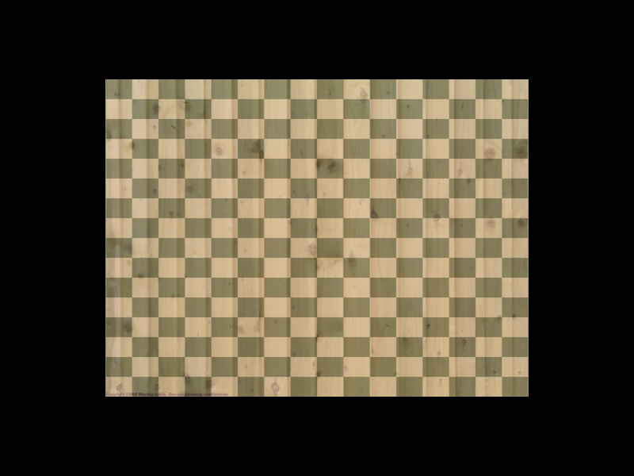
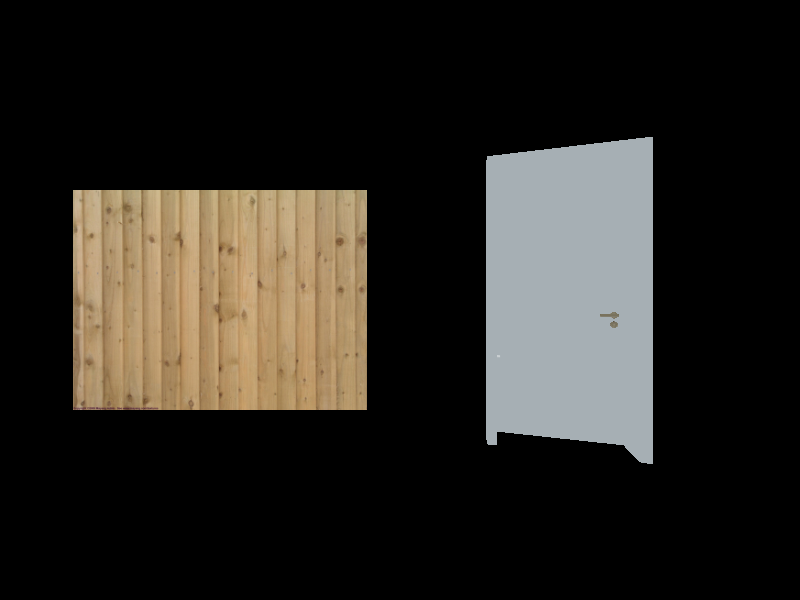
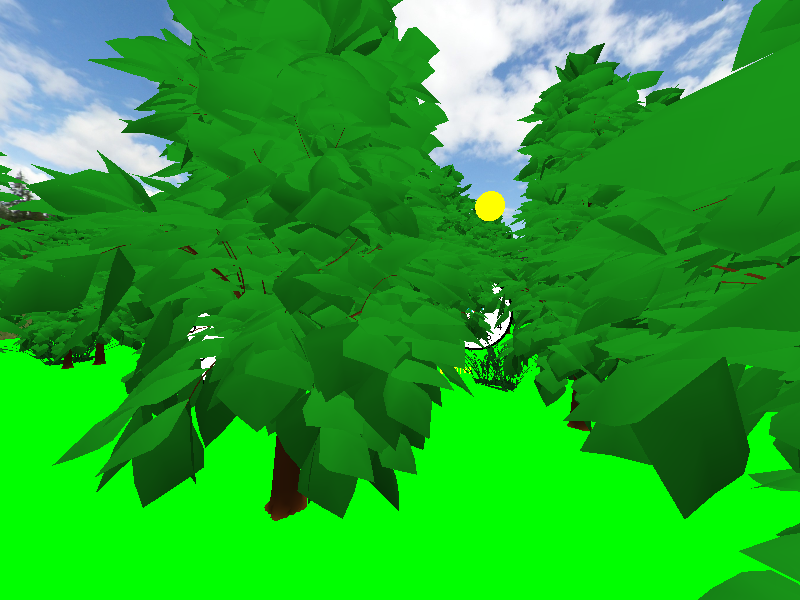
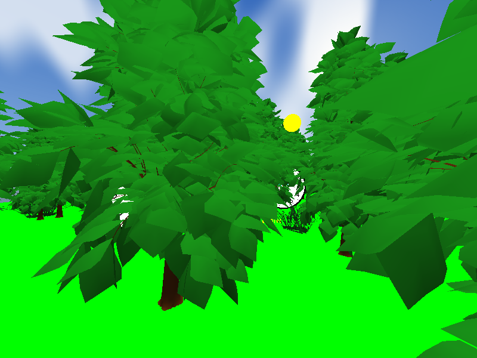

# Úloha 8 - Textúry, viac textúrovacích jednotiek, skybox a skydome

Autor projektu: Martin Jarabica, jar0193

Obdobie: 4. až 8. november 2026. Poznámky vychádzajú zo zadania LMS, prednášky 7 a aktuálneho projektu. Pripravené s pomocou AI. Ukážky sú fragmenty zdrojov a nemusia byť samostatne spustiteľné.

## 1. Týždenný prehľad

Cieľom je pridať rastrové textúry k modelom, rozlíšiť textúru od textúrovacej jednotky a použiť textúry aj ako pozadie scény. Implementácia používa `stb_image`, OpenGL 4.3 a shadery GLSL 4.10.

Z prednášky boli užitočné najmä slajdy 14-18 o UV, 23-26 o jednotkách a sampler uniformoch, 32-37 o filtrovaní a mipmapách a 38-47 o cubemape a oblohe. Slajd 12 opisuje procedurálne textúry, ktoré používame pre skydome a detailovú mapu. Skybox používa fotografie z učiteľovho archívu `skybox.zip`.

## 2. Čo sme spravili

| Bod LMS | Stav | Riešenie |
| --- | --- | --- |
| 1. Model s UV | Splnené | `plain_uv.h`, formát pozícia + normála + UV |
| 2. Tri atribúty | Splnené | `Model.cpp`, atribút 2 má pri ôsmich hodnotách veľkosť 2 |
| 3. stb_image | Splnené | `Texture`, načítanie RGBA a odoslanie do GPU |
| 4. Limit jednotiek | Splnené | `GL_MAX_TEXTURE_IMAGE_UNITS`, výpis pri štarte |
| 5. Fragment shader | Splnené | `texture.frag`, `sampler2D` a `texture()` |
| 6. Ukážka textúry | Splnené | F1 rovina s drevom, F2 textúrovaný model dverí |
| 7. Viac textúr | Splnené | F3 dva samplery na jednom modeli, F4 dva modely s rôznymi textúrami |
| 8. Skybox a skydome | Splnené | F5 cubemap na krychli, F6 panoráma na sfére |
| 2a–2c. Učebňa EB408 | Splnené | F5, stoly, stoličky, dvere, Shrek a whiteboard so stranou 36 prednášky 7 |
| 2d. Video | Splnené | `Tasks/8.task/jar0193_EB408.mp4`; autor 8. 11. 2026 potvrdil nahratie na spoločný Discord |
| Login a MSAA | Splnené | `jar0193` v pravom hornom rohu každej scény, 4× MSAA |

### Ovládanie

| Kláves | Ukážka |
| --- | --- |
| F1 | Drevený plot na rovine |
| F2 | Dvere, zárubňa a kľučka s pôvodnými UV |
| F3 | Drevo a opakovaná detailová šachovnica na jednom modeli |
| F4 | Rovina a dvere v jednej scéne, každý model má vlastnú textúru |
| F5 | Učebňa EB408 s existujúcim skyboxom |
| F6 | Denný les so skydomom |
| 0-9 | Pôvodné scény s pôvodným pozadím |

WASD a pravé tlačidlo myši ovládajú spoločnú kameru. W/S používajú celý smer pohľadu: pri pohľade nahor a držaní W kamera stúpa, pri pohľade nadol klesá. A/D posúvajú kameru do strán. Výška je os Y. Šípky posúvajú aktívny objekt, Q/E ho otáčajú, Z/X menia veľkosť. Vo F4 sa ovláda rovina, vo F5 učebňa a vo F6 prvý strom. Samotný denný les zostáva na klávese 4.

Vybavená učebňa má 18 študentských miest a učiteľský stôl pri nízkom obdĺžnikovom okne. Učiteľský stôl je otočený o 90° a stolička je na strane pri stene, aby mal sediaci učiteľ stenu za chrbtom. Shrek stojí pod učiteľským stolom. Lavice aj študentské stoličky sú posunuté o 0,30 m smerom k tabuli. Pôvodná zárubňa obsahuje doplnené krídlo dverí. Na whiteboarde je strana 36 prednášky 7 o filtrovaní textúr; login je text bez rámu a pozadia, spoločný pre všetky scény. Podrobnosti importu a prípravy modelov sú v `MODEL_IMPORT.md`. Aktuálne screenshoty, video a stručný súhrn zadania sú v `Tasks/8.task`.

## 3. Ako sme to spravili (Ukážky kódu & Vysvetlenie)

### 3.1 UV súradnice a formát vrcholu

Nový formát má osem hodnôt typu `float`:

```cpp
// Position        Normal             UV
   x, y, z,       nx, ny, nz,        u, v
```

Šesť vrcholov roviny vytvára dva trojuholníky. UV súradnice hovoria, kde v obrázku leží bod povrchu. Interpolujú sa medzi vrcholmi trojuholníka.

```cpp
glVertexAttribPointer(
    2, 2, GL_FLOAT, GL_FALSE,
    8 * sizeof(float), (void*)(6 * sizeof(float))
);
```

Prvá dvojka je index atribútu, druhá počet zložiek. Stride je vzdialenosť začiatkov vrcholov. Offset preskočí pozíciu a normálu. Pôvodné formáty so šiestimi alebo deviatimi hodnotami zostali podporované.

### 3.2 Načítanie obrázka a pamäť

`STB_IMAGE_IMPLEMENTATION` zostáva definované iba v `Application.cpp`. Ostatné súbory zahŕňajú samotné deklarácie z `stb_image.h`.

Trieda `Texture` načíta obrázok do CPU pamäte, pošle ho do GPU a vlastní výsledný OpenGL objekt:

```cpp
stbi_set_flip_vertically_on_load(true);
stbi_load(filename, &width, &height, &channels, 4);

glTexImage2D(GL_TEXTURE_2D, 0, GL_RGBA8, width, height, 0,
    GL_RGBA, GL_UNSIGNED_BYTE, pixels.get());
glGenerateMipmap(GL_TEXTURE_2D);
```

Posledná štvorka v `stbi_load` požaduje RGBA aj pri RGB obrázku. CPU pixely sa po nahratí uvoľnia. GPU objekt sa uvoľní cez `glDeleteTextures` v deštruktore. OpenGL kontext pri tom ešte musí existovať.

Opakovanie používa `GL_REPEAT`. Zmenšovanie používa `GL_LINEAR_MIPMAP_LINEAR`, zväčšovanie `GL_LINEAR`. Mipmapy sú menšie úrovne toho istého obrázka.

### 3.3 Textúra, jednotka a sampler

Tieto pojmy majú rozdielny význam:

| Pojem | Význam |
| --- | --- |
| Textúra | OpenGL objekt s obrázkovými dátami |
| Textúrovacia jednotka | Miesto, ku ktorému pripájame textúru pri kreslení |
| Sampler uniform | Určuje, z ktorej jednotky má shader čítať |

```cpp
glActiveTexture(GL_TEXTURE0 + unit);
glBindTexture(GL_TEXTURE_2D, id);
program.setUniform("textureUnitID", 0);
```

Sampler dostáva index jednotky, napríklad `0`, cez `glUniform1i`. Nedostáva ID obrázka ani hodnotu konštanty `GL_TEXTURE0`.

`GL_MAX_TEXTURE_IMAGE_UNITS` je limit dostupný fragment shaderu. Výpis pri kontrole tohto projektu bol 32; aplikácia číta skutočnú hodnotu pri každom štarte.

### 3.4 Jeden model s dvoma textúrami - F3

`DrawableObject` si pamätá odkazy na textúry a ich jednotky. Pred kreslením ich pripojí a po kreslení obnoví predchádzajúce väzby aj aktívnu jednotku.

```cpp
multiTextureObject.setTexture(fenceTexture, 0);
multiTextureObject.setTexture(detailTexture, 1);
multiTextureProgram.setUniform("baseTexture", 0);
multiTextureProgram.setUniform("detailTexture", 1);
```

Fragment shader odoberie farbu z oboch obrázkov:

```glsl
vec4 base = texture(baseTexture, uv);
vec4 detail = texture(detailTexture, uv * 8.0);
FragColor = vec4(mix(base.rgb, detail.rgb, detailStrength), base.a);
```

`uv * 8.0` opakuje detailovú textúru osemkrát v oboch smeroch. Pri `detailStrength = 0.4` výsledok tvorí 60 percent dreva a 40 percent detailu. Šachovnica je zámerne výrazná, aby bolo vidno použitie druhého obrázka.

### 3.5 Viac modelov s rôznymi textúrami - F4

V jednej scéne sú rovina a model dverí. Každý má vlastnú textúru na jednotke 0 a zdieľajú rovnaký shader. Pred každým draw callom sa pripojí správny obrázok daného objektu.

Rozdiel oproti F3: dva modely môžu postupne použiť jednu jednotku. Ak jeden shader potrebuje pri jednom kreslení čítať dva obrázky, pripojíme ich k dvom jednotkám súčasne.

Dvere sú exportované z `Door.blend` pomocou `tools/export_textured_model_to_header.py`. Model obsahuje 496 trojuholníkov, dvere aj zárubňu, normály a pôvodné UV. Kamera, svetlá a pomocné objekty z Blenderu sa neexportujú.

### 3.6 Skybox - F5

`SkyRenderer` načíta šesť pôvodných JPG z učiteľovho `skybox.zip`, každé s rozlíšením 2048 x 2048, do jedného cubemap objektu:

| Súbor | Cubemap plocha |
| --- | --- |
| posx.jpg | +X |
| negx.jpg | -X |
| posy.jpg | +Y |
| negy.jpg | -Y |
| posz.jpg | +Z |
| negz.jpg | -Z |

Obrázky sa vertikálne neotáčajú; ich riadky už zodpovedajú orientácii OpenGL cubemap plôch. Cubemap používa `GL_CLAMP_TO_EDGE` vo všetkých troch osiach a zapnuté `GL_TEXTURE_CUBE_MAP_SEAMLESS`. Obsah pôvodných JPG zostal nezmenený.

Archív obsahuje aj `skybox.obj`, teda kocku. V aplikácii už jednotkovú kocku vytvárame priamo z vrcholov, preto na skybox netreba pridávať OBJ importer. Veľkosť kocky neovplyvňuje výber vzorky: pre cubemap je rozhodujúci smer.

```glsl
direction = position;
vec4 clip = projectionMatrix * mat4(mat3(viewMatrix)) * vec4(position, 1.0);
gl_Position = clip.xyww;
```

Lokálna poloha vrcholu krychle je smer pre `samplerCube`. Funkcia `texture(skyTexture, direction)` sama vyberie príslušnú plochu.

### 3.7 Skydome - F6

Skydome je sféra so 96 dielmi v zemepisnej dĺžke a 48 v šírke. Má vlastné UV a používa jednu panoramatickú 2D textúru. Plná sféra pokrýva aj smery pod horizontom. Na oboch póloch sa vzorka neopakuje vertikálne; horizontálne je panoráma periodická.

F5 používa učiteľove fotografie okolia a F6 procedurálnu panorámu oblohy. Rozdiel je aj v geometrii a mapovaní: cubemap odoberá podľa 3D smeru, skydome podľa 2D UV.

### 3.8 Pohyb kamery a hĺbkový buffer

`mat4(mat3(viewMatrix))` zachová rotáciu a odstráni posun kamery. Pri pohybe WASD sa teda obloha neodsunie; pri otočení myšou sa zmení smer pohľadu na oblohu. Sky programy sú pripojené cez existujúci Observer kamery, preto dostávajú aj nové projekčné matice pri resize.

Kamera sa pohybuje dopredu/dozadu v plnom 3D smere pohľadu:

```cpp
eye += glm::normalize(target) * distance;
updateView();
```

Predchádzajúca verzia vynulovala zložku Y smeru, a tým obmedzila W/S na vodorovnú rovinu XZ. Teraz výšku ovplyvňuje natočenie kamery myšou. Záporná vzdialenosť pri S znamená pohyb opačne od smeru pohľadu. Nové klávesy na stúpanie a klesanie nie sú potrebné.

`clip.xyww` dá po perspektívnom delení hĺbku 1, teda vzdialené pozadie. Počas vykreslenia oblohy používame:

```cpp
glDepthMask(GL_FALSE);
glDepthFunc(GL_LEQUAL);
```

Obloha sa vykreslí po vymazaní buffera a pred lesom. Nezapíše hĺbku, preto sa stromy a zem neskôr normálne vykreslia pred ňou. Po kreslení sa obnoví pôvodný depth test, zápis hĺbky, culling, shader program, VAO a textúrovacie väzby.

### 3.9 Odkiaľ pochádzajú nové obrázky

Skybox tvorí šesť nezmenených JPG z učiteľovho `skybox.zip`. Sú uložené v `project/Textures/skybox`.

Detailovú šachovnicu a panorámu pre skydome generuje `tools/generate_exercise8_textures.py`. Panoráma používa gradient oblohy, jednoduché procedurálne oblaky a slnko. Obrázky sa pri spustení aplikácie nesťahujú ani negenerujú.

Generátor potrebuje NumPy a Pillow iba pri opätovnom vytváraní PNG. Bežný beh C++ aplikácie ich nepotrebuje; obrázky už sú uložené v `project/Textures`.

## 4. Code Review & Poznatky

- `Texture` vlastní GPU obrázok a uvoľní ho automaticky. `DrawableObject` si textúry iba požičiava.
- Príprava F1-F4 je po zjednodušení projektu zo 7. 11. 2026 priamo v `Application.cpp`. Modely, textúry, programy a transformácie sú lokálne premenné, ktoré žijú počas celej hlavnej slučky.
- F1 a F3 zdieľajú model roviny; F2 a F4 model dverí. Samostatný obrázok nevyžaduje ďalší VBO pre rovnakú geometriu.
- `SkyRenderer` vlastní geometriu oblohy a cubemap. Oba jeho programy spolupracujú s existujúcim Observerom kamery.
- `Texture` rieši načítanie obrázka a `SkyRenderer` vykreslenie oblohy. `Application.cpp` priamo vytvára scény, vyberá ukážku a nastavuje režim oblohy.
- Chýbajúci obrázok sa oznámi cez výnimku; čiastočne vytvorené zdroje sa uvoľnia pred zánikom OpenGL kontextu.
- Toto cvičenie nemení odovzdávacie kópie predchádzajúcich úloh v `Tasks`.

### Overenie

- Debug x64 zostavenie vo Visual Studiu/MSBuild prešlo.
- Po zjednodušení štruktúry zo 7. 11. 2026 prešlo nové Debug/x64 zostavenie. Všetkých 66 hlavných a 18 okrajových scenárov zostalo pixelovo zhodných s aktuálnou verziou pred presunom. Overili sa aj oba prípady chýbajúceho obrázka.
- Po zapojení učiteľovho skyboxu a priestorového letu kamery sa overilo 66 scenárov. Všetkých 52 neovplyvnených obrázkov sa zhoduje s predchádzajúcou verziou po jednotlivých pixeloch.
- GPU dáta štyroch 2D textúr boli overené voči zdrojovým PNG vrátane orientácie. Šesť JPG skyboxu bolo zachovaných presne podľa učiteľovho archívu.
- Farby vo F3 boli porovnané s nezávisle vypočítanou kombináciou oboch vstupných obrázkov.
- Skontrolovalo sa pokrytie celého okna oblohou, resize, rotácia a posun kamery, šesť smerov pohľadu a spoj cubemap plôch.
- Pri čistom posune kamery zostáva samotná obloha rovnaká, pri otočení myšou sa mení smer pohľadu.
- Poradie aj orientácia šiestich učiteľových plôch sa overili proti nezávislému výpočtu cubemap vzorkovania a kontrolou všetkých 12 spojov.
- Let pri pohľade nahor/nadol bol overený spolu s opačným pohybom S a aktualizáciou pozície kamery v shaderoch cez Observer.
- Obloha nemení depth buffer a obnoví pôvodný stav OpenGL. Po návrate na číselnú scénu zostane jej pôvodné pozadie.
- Pri chýbajúcej detailovej textúre aj pri chýbajúcej cubemap ploche sa prostriedky uvoľnia pred zánikom kontextu.
- Kontroly a dočasné snímky zostali mimo repozitára. Nasledujúce obrázky sú skutočné snímky OpenGL, so zafixovaným rozmiestnením lesa pre opakovateľnosť.

### Ukážky výsledku

F3 - dva obrázky na jednom modeli:



F4 - dva modely s rôznymi obrázkami:



Predchádzajúca ukážka F5 - denný les so skyboxom (od 8. 11. 2026 je na F5 učebňa EB408):



F6 - ten istý les so skydomom:


